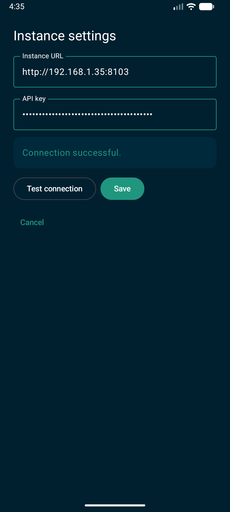
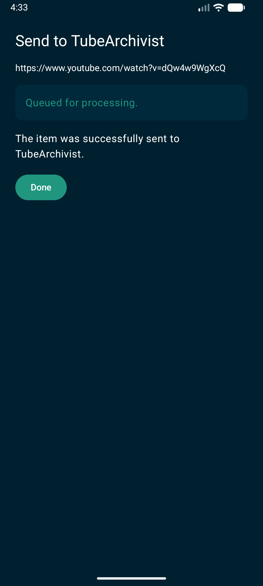

# TubeArchivist Share

Native Android share target for sending one YouTube URL to a TubeArchivist instance. Requires Android 11 (API 30) or newer.

  

On first launch, enter the TubeArchivist instance base URL and an API token for an admin account. The app tests the token with the authenticated download-queue endpoint and stores the configuration encrypted with Android Keystore. HTTPS is preferred. HTTP is allowed for explicitly configured self-hosted instances, but is unencrypted and is warned about in the app.

Share a single YouTube video URL from another app to submit it. Playlist and channel links are also supported; the app will then ask for confirmation. The app submits items without forcing automatic download start. A successful response means TubeArchivist accepted an asynchronous processing request, not that every item was queued or downloaded.

> [!NOTE]
> **Disclaimer:** this app was almost entirely created with GPT-6 Luna.
