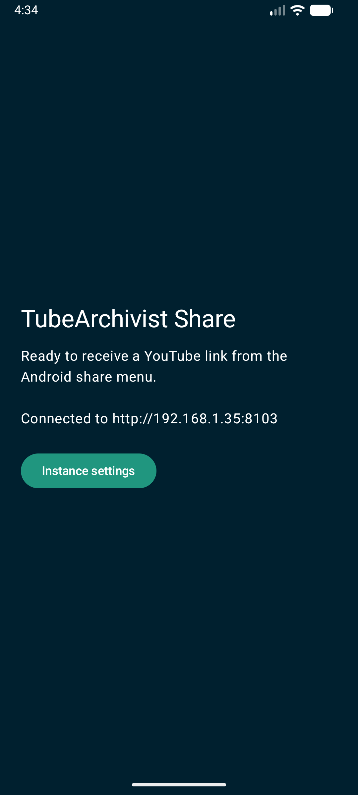
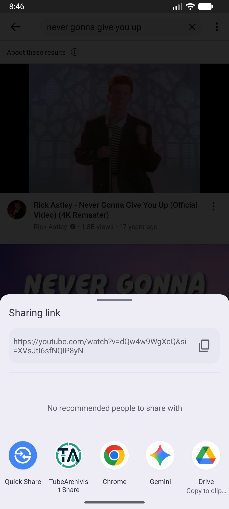

# TubeArchivist Share

Native Android share target for sending one YouTube URL to a TubeArchivist instance.

   

## Installation

Download the compiled APK from the [Releases](https://github.com/mistic100/tubearchivist-android-share/releases) page. You will have to allow to install unknown apps on your device.

Requires Android 11 (API 30) or newer.

## Usage

On first launch, enter the TubeArchivist instance URL and your API key. The app tests the token with the authenticated download-queue endpoint and stores the configuration encrypted with Android Keystore. HTTPS is preferred. HTTP is allowed for explicitly configured self-hosted instances.

Share a single YouTube video URL from another app to submit it. Playlist and channel links are also supported; the app will then ask for confirmation. A successful response means TubeArchivist accepted an asynchronous processing request, not that every item was queued or downloaded.

The app checks for new GitHub releases once every 24 hours. When an update is available, a download card appears on the home and share screens.

> [!NOTE]
> **Disclaimer:** this app was almost entirely created with GPT-6 Luna.
